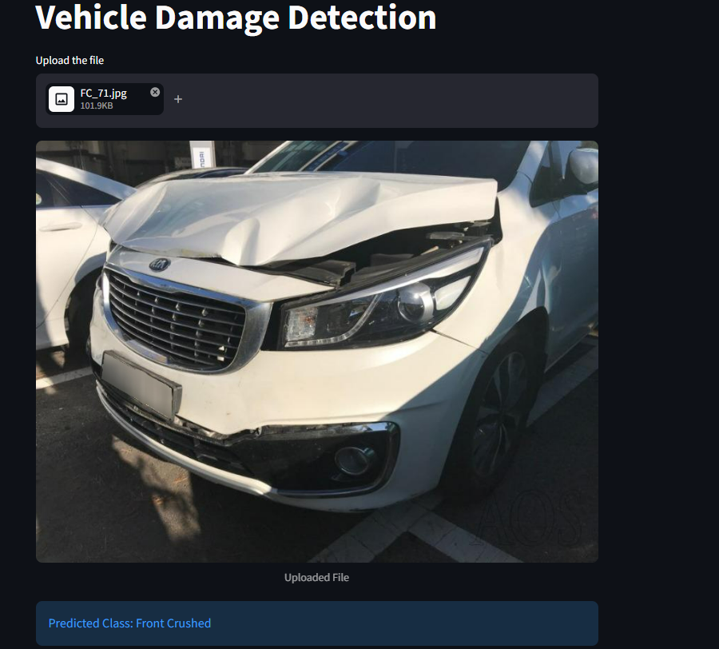

# Vehicle-Damage-Detection
A Streamlit-based web application powered by a custom ResNet50 model to detect and classify vehicle damage from images. This tool assists vehicle owners and insurance companies in instantly categorizing car damage into six distinct classes based on uploaded photos.

## 📌 Overview & Key Features

* **Multi-Class Classification:** Instantly categorizes vehicle condition into **6 distinct categories**:
  * 🟢 `Front Normal`
  * 🟡 `Front Breakage`
  * 🔴 `Front Crushed`
  * 🟢 `Rear Normal`
  * 🟡 `Rear Breakage`
  * 🔴 `Rear Crushed`
* **Real-time Inference:** Fast damage predictions via a Streamlit web interface.
* **Production-Ready:** Modular architecture separating the Streamlit interface, FastAPI backend, and inference logic.

---

## 🤖 Model Details

| Attribute | Details |
| :--- | :--- |
| **Architecture** | ResNet50 (Transfer Learning with pre-trained ImageNet weights) |
| **Dataset Size** | 2,300 labeled car images |
| **Validation Accuracy** | ~80% |
| **Data Augmentation** | Contrast variations, random rotations, and color jitter for robustness |

---

## 🛠️ Tech Stack

* **Backend & ML:** Python, PyTorch, TorchVision, FastAPI
* **Frontend & Deployment:** Streamlit, Streamlit Cloud
* **Analytics & Hyperparameter Tuning:** Scikit-learn, Optuna, Matplotlib
---

🚀 How to Run Locally
1. Clone the Repository
   git clone [https://github.com/mishkat91/Vehicle-Damage-Detection.git]

2. Install Dependencies
   pip install -r requirements.txt

3. Launch the Application
   streamlit run app.py

📸 Screenshots

| Front Crushed Detection |
| :---: |
|  |
